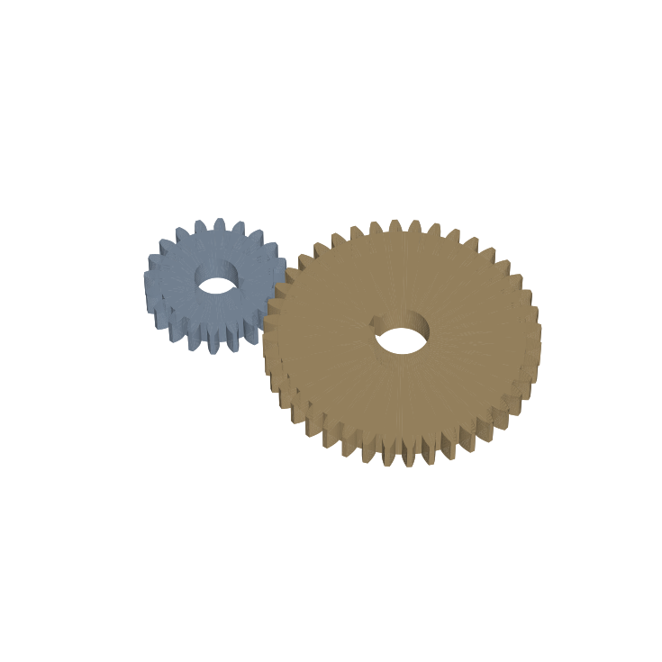

# Involute Gear CAD

Parametric 3D CAD of a **meshed involute spur gear pair**, built with [CadQuery](https://github.com/CadQuery/cadquery). The teeth follow the true involute curve, which is generated from the base circle rather than drawn as circular arcs. The repo exports STEP files for SOLIDWORKS and other CAD programs, STL meshes, a top-view drawing and a gear data report.



## The pair

| | Pinion | Gear |
| --- | --- | --- |
| Teeth | 20 | 40 |
| Module | 3 mm | 3 mm |
| Pressure angle | 20° | 20° |
| Pitch diameter | 60 mm | 120 mm |
| Base diameter | 56.38 mm | 112.76 mm |
| Outside diameter | 66 mm | 126 mm |
| Root diameter | 52.5 mm | 112.5 mm |
| Face width | 20 mm | 20 mm |
| Bore + keyway | 20 mm + 6 mm key | 25 mm + 6 mm key |
| Mass (steel) | 0.38 kg | 1.68 kg |

**Ratio 2:1 · center distance 90 mm · contact ratio 1.64 · backlash 0.10 mm**

## The math

Involute flank, from the base circle radius r_b:

```latex
x = r_b(\cos t + t\sin t), \qquad y = r_b(\sin t - t\cos t)
```

The tooth half-angle at radius r uses the involute function inv(α) = tan α − α:

```latex
\theta(r) = \frac{\pi}{2z} + \mathrm{inv}(\phi) - \mathrm{inv}(\alpha_r), \qquad \cos\alpha_r = \frac{r_b}{r}
```

The standard proportions are pitch d = m·z, outside d = m(z + 2), root d = m(z − 2.5) and center distance a = m(z₁ + z₂)/2. The contact ratio is the length of the line of action divided by the base pitch.

## How the models are checked

Most CAD projects only show a picture. This one proves the gears work:

| Test | What it proves |
| --- | --- |
| Meshed pair overlap = 0 mm³ | Teeth sit in each other's gaps at assembly |
| Rotate pinion 4° and 8°, gear −2° and −4°: still 0 mm³ | True conjugate (involute) action through the mesh |
| Rotate only the pinion 6°: overlap above 100 mm³ | The teeth are really in contact, not just spaced apart |
| 12 teeth rejected | Undercut check (20° full-depth needs at least 17 teeth) |
| Different modules rejected | Gears must share module to mesh |

11 pytest tests, all passing.

## Connects to

[drivetrain-gear-calculator](https://github.com/gomdan133-ux/drivetrain-gear-calculator): the ratio math there, made physical here.

## Files

```
gearcad/gear.py     GearSpec, build_gear(), build_pair(), center_distance(), contact_ratio()
scripts/build_all.py
output/  pinion_20T.step, gear_40T.step, gear_pair_assembly.step,
         *.stl, gear_pair_top.svg, gear_pair.png, gear_report.json
tests/test_gears.py
```

```bash
pip install cadquery matplotlib pytest
python scripts/build_all.py
pytest -q
```

## How this was built

1. **Started from gear theory.** I used standard full-depth teeth with a 20° pressure angle, and generated each flank from the involute function, not with the circular-arc shortcut many hobby models use.
2. **Modeled with splines.** Each flank is a spline through points on the true involute. I switched from straight segments to splines to make the STEP files about 3× smaller and smoother, which is how commercial CAD represents them.
3. **Built the pair at the correct center distance,** with the gear rotated half a tooth so a pinion tooth sits in a gear gap. Backlash is split between the two gears.
4. **Used solid intersection tests to prove the mesh.** There's zero overlap at assembly and through conjugate rotation, and a collision when only one gear turns.
5. **Exported** STEP files (each part plus the assembly), STL meshes, a drawing view, a render and a JSON gear data report.

**Limits:** spur gears only, with no profile shift, tip relief or root fillet curve (the root is straight). Not for manufacturing without a gear designer's review.

## License

MIT
